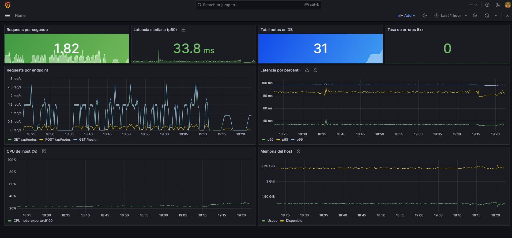

# TP08 - Monitoreo con Prometheus y Grafana

App de notas (Flask + Postgres + Nginx) del TP06 con un stack de monitoreo completo.

## Stack completo

| Servicio      | Puerto (servidor) | Funcion                                         |
|---------------|-------------------|-------------------------------------------------|
| Frontend      | :8090             | Nginx, proxy hacia la API                       |
| App Flask     | :5000             | Expone /metrics con prometheus_client           |
| Prometheus    | :9091 (9090 en la red de Docker) | Scrape cada 15s, retencion 15 dias |
| Grafana       | :3000             | Dashboards + provisioning automatico            |
| Node Exporter | :9100             | CPU, RAM, disco y red del host                  |
| cAdvisor      | :8080 (interno)   | Metricas de contenedores Docker                 |

Prometheus se publica en el 9091 porque el 9090 del servidor lo usa Cockpit.

## Acceso

    cp .env.example .env
    docker compose up -d
    bash scripts/verificar-monitoreo.sh

- Grafana: http://localhost:3000 (usuario admin, contrasena GRAFANA_PASSWORD del .env; por defecto devops123)
- Prometheus: http://localhost:9091

## Dashboard: 8 paneles

- Requests por segundo (stat)
- Latencia mediana p50 (stat)
- Total notas en DB (stat)
- Tasa de errores 5xx (stat)
- Requests por endpoint (timeseries)
- Latencia p50/p95/p99 (timeseries)
- CPU del host (timeseries)
- Memoria del host (timeseries)

## Alertas configuradas

- AppDown: backend caido por mas de 1 minuto
- HighCPU: CPU > 80% por 2 minutos
- HighErrorRate: errores 5xx > 5% por 1 minuto
- DiskSpaceLow: disco > 85% por 5 minutos

## Metricas propias de la app

    app_requests_total            # contador por metodo/endpoint/status
    app_request_duration_seconds  # histograma de latencia
    app_notes_total               # gauge: notas en la DB
    app_db_errors_total           # contador de errores de DB
    app_info                      # version y entorno

## Nota sobre gunicorn

El backend corre con 1 worker y 4 threads. prometheus_client guarda las metricas
en la memoria de cada proceso: con 2 workers, cada consulta a /metrics devolvia
los contadores de uno u otro y los valores saltaban. Con 1 worker las metricas
son consistentes.
